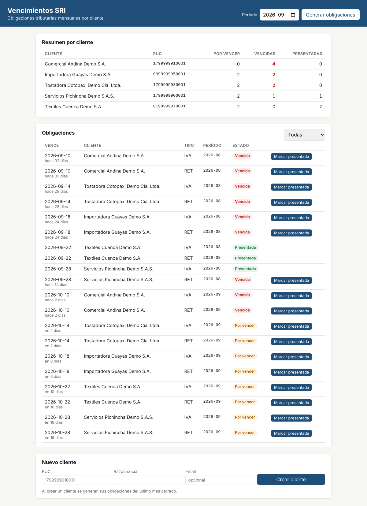

# Vencimientos SRI

Aplicación full stack para dar seguimiento a las **obligaciones tributarias mensuales** (IVA y retenciones en la fuente) de una cartera de clientes en Ecuador:

- Calcula la fecha de vencimiento de cada declaración según el **noveno dígito del RUC**.
- Muestra qué está por vencer o vencido.
- Permite marcar declaraciones como presentadas.



**Stack:** React 19 · TypeScript · SASS · Vite · Python · FastAPI · MySQL 8 · Vitest · pytest · mutmut · Docker · GitHub Actions

## Funcionalidades

- Resumen por cliente: obligaciones por vencer, vencidas y presentadas.
- Listado de obligaciones con filtro por estado y días restantes.
- Alta de clientes con validación de RUC en el navegador y en el servidor. Al crear un cliente se generan sus obligaciones del último mes cerrado.
- Generación de obligaciones de un período para toda la cartera. Es idempotente: ejecutarla dos veces no duplica registros.
- Marcado de obligaciones como presentadas, con registro en bitácora.
- Documentación interactiva de la API en `/docs` (Swagger, generada por FastAPI).

## Arquitectura

```
frontend/  React + TypeScript + SASS (Vite)  ──fetch /api──▶  app/  FastAPI  ──SQL──▶  MySQL
              ▲                                                    │
              └── tipos generados del contrato OpenAPI ◀───────────┘
```

**Contrato tipado entre backend y frontend.** Los modelos Pydantic del backend definen el contrato OpenAPI:
1. `scripts/exportar_openapi.py` exporta el contrato a `frontend/openapi.json`.
2. `npm run gen:api` genera los tipos TypeScript (`src/api/schema.d.ts`) a partir de ese archivo.

Si alguien cambia un campo de la API, el frontend **deja de compilar** en vez de fallar en producción. Además, la CI regenera el contrato y falla si no coincide con el que está versionado.

**Componentes del frontend** (`frontend/src/`):

| Archivo | Responsabilidad |
|---|---|
| `api/client.ts` | Cliente HTTP tipado y manejo de errores de FastAPI (`detail` de texto o lista de validación 422) |
| `App.tsx` | Estado de la página, carga de datos y acciones |
| `components/ObligacionesTabla.tsx` | Tabla con filtro; deshabilita el botón mientras la petición está en curso (evita el doble envío) |
| `components/NuevoClienteForm.tsx` | Formulario con validación del RUC antes de llamar a la API |
| `styles/` | SASS: variables, mixins y un mapa de estados que genera las clases de cada badge |

## Calidad: pruebas en cuatro niveles

| Nivel | Herramienta | Qué verifica |
|---|---|---|
| Unitarias (backend) | pytest | Regla de vencimiento para los 10 dígitos del RUC, validaciones |
| Integración (backend) | pytest + MySQL real | Transacciones, idempotencia, conflictos (409), agregaciones SQL |
| **Mutación** (backend) | mutmut | Que las pruebas detecten cambios deliberados en la lógica de negocio |
| Unitarias y de componentes (frontend) | Vitest + Testing Library | Formateo, cliente HTTP, interacción de la tabla y flujos completos de la app con el backend simulado |
| **Contrato** | OpenAPI → TypeScript | Que el frontend y la API acuerden la forma de cada respuesta |

**Pruebas de mutación.** mutmut introduce errores pequeños en el código, por ejemplo cambiar `mes == 12` por `mes != 12` o `+ 1` por `- 1`, y vuelve a correr las pruebas. Si ninguna prueba falla, el mutante "sobrevive" y queda en evidencia una prueba débil.

En `app/vencimientos.py` se detectan los **40 mutantes de 40**, y la CI falla si alguno sobrevive. mutmut solo muta funciones, no constantes, así que la tabla de días por dígito se verifica completa en una prueba aparte.

```bash
pytest -v                    # backend: 24 pruebas
mutmut run && mutmut results # mutación (results vacío = ningún sobreviviente)
cd frontend && npm test      # frontend: 29 pruebas
```

## Seguridad (OWASP Top 10)

- **Inyección (A03):** todas las consultas SQL van parametrizadas. Los filtros dinámicos se arman solo con fragmentos fijos del código, nunca con texto del usuario.
- **XSS:** React escapa por defecto todo el texto que se muestra. No se usa `dangerouslySetInnerHTML`.
- **Validación de entrada:** el backend valida RUC, período y email con Pydantic aunque el frontend ya los valide. El navegador nunca es la única barrera.
- **Errores:** las respuestas de error devuelven mensajes de negocio (`404`, `409`, `422`), sin trazas internas.

## Accesibilidad

- Encabezados de tabla con `scope` y `label` asociados a cada control.
- Botones con `aria-label` descriptivo ("Marcar como presentada: IVA 2026-09 de …").
- Errores de formulario enlazados con `aria-invalid` y `aria-describedby`.
- Notificaciones en una región `aria-live`.
- Foco visible con teclado.

## Base de datos

El acceso a datos usa **SQL explícito con PyMySQL**, sin ORM:

| Concepto | Dónde |
|---|---|
| Modelado relacional, claves foráneas, `UNIQUE` | `db/01_schema.sql` |
| Índice compuesto `(estado, fecha_vencimiento)` para la consulta más frecuente | `db/01_schema.sql` |
| `JOIN` de tres tablas y estado derivado con `CASE` | `app/routers/obligaciones.py` → `consultar_obligaciones` |
| `LEFT JOIN` + `GROUP BY` + agregaciones condicionales | `app/routers/clientes.py` → `resumen_por_cliente` |
| Subconsultas correlacionadas (`EXISTS` y escalares) | `app/routers/clientes.py` → `clientes_con_vencidas` |
| Transacciones con `COMMIT`/`ROLLBACK` y bloqueo `SELECT ... FOR UPDATE` | `app/db.py`, `marcar_presentada` |
| Idempotencia con `INSERT IGNORE` + restricción única | `app/routers/obligaciones.py` → `generar_periodo` |

El estado **"vencida" no se almacena**: se calcula a partir de `estado` y `fecha_vencimiento`, así nunca queda desactualizado.

## Ejecutar

### Con Docker (recomendado)

```bash
docker compose up --build
```

Abrir <http://localhost:8000>. El `Dockerfile` es multi-etapa: compila el frontend con Node y copia solo los archivos estáticos a la imagen final de Python. Para ver obligaciones, usar **Generar obligaciones** con el período que se quiera.

### Desarrollo local

Requiere Python 3.11+, Node 20+ y MySQL 8 con una base `vencimientos` y un usuario `app`/`app` (o ajustar `.env.example`).

```bash
# Backend
python -m venv .venv && source .venv/bin/activate   # Windows: .venv\Scripts\activate
pip install -r requirements.txt
mysql -u app -p vencimientos < db/01_schema.sql
mysql -u app -p vencimientos < db/02_seed.sql
uvicorn app.main:app --reload                        # http://localhost:8000

# Frontend (otra terminal): servidor de desarrollo con recarga en caliente
cd frontend
npm install
npm run dev                                          # http://localhost:5173 (reenvía /api al backend)
```

Si cambias la API, regenera el contrato:

```bash
python scripts/exportar_openapi.py && cd frontend && npm run gen:api
```

## Integración continua

`.github/workflows/ci.yml` corre en cada push y Pull Request:

- **Backend:** pytest contra un servicio MySQL 8, y después las pruebas de mutación.
- **Frontend:**
  1. Verificación del contrato OpenAPI.
  2. Typecheck estricto de TypeScript.
  3. Vitest.
  4. Build de producción.

## Historial

- **v1:** frontend en JavaScript sin frameworks.
- **v2:** migración a React + TypeScript + SASS con contrato tipado, pruebas de frontend y pruebas de mutación. El backend no cambió, salvo para servir el build.

## Alcance y simplificaciones

La regla de vencimiento usa el calendario general del SRI para declaraciones mensuales: noveno dígito 1 → día 10, 2 → 12, …, 9 → 26 y 0 → 28 del mes siguiente. **No** contempla:
- el traslado por feriados o fines de semana;
- los calendarios especiales (contribuyentes especiales, Galápagos, prórrogas por resolución).

Es un proyecto de práctica: para uso real, verificar el calendario vigente en [sri.gob.ec](https://www.sri.gob.ec). Los RUC y razones sociales de los datos de ejemplo son ficticios.
